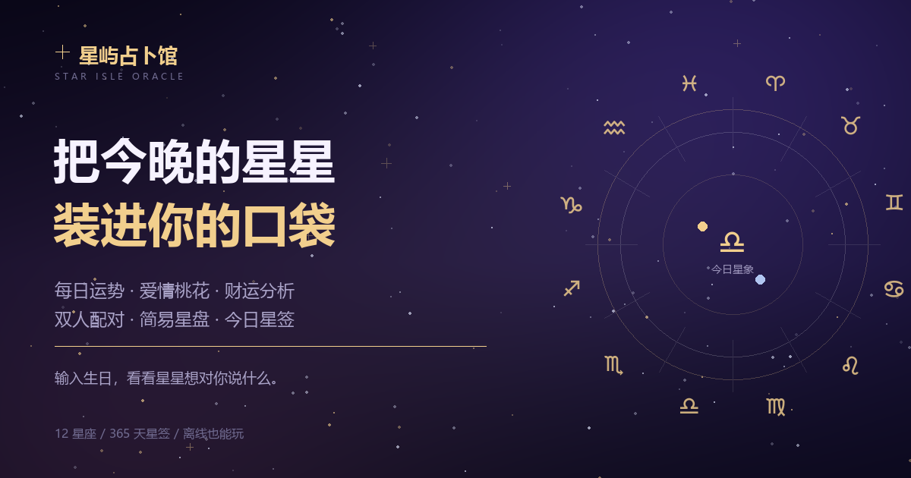
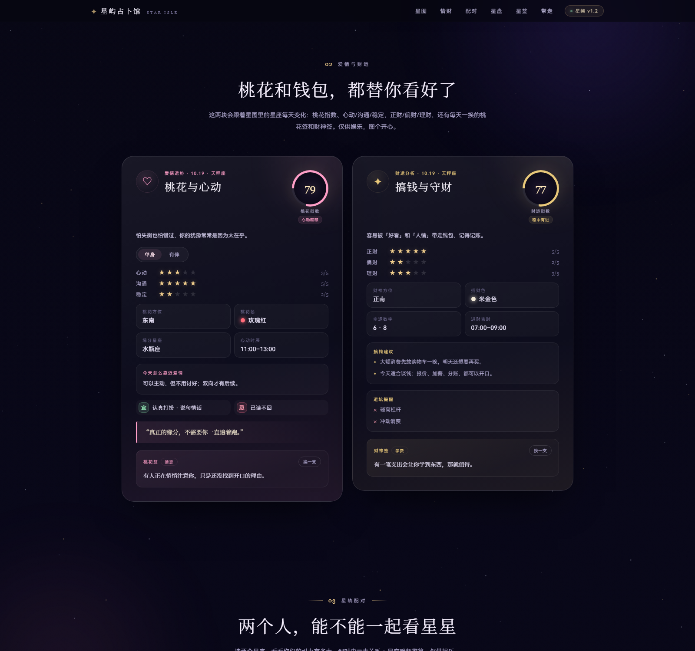
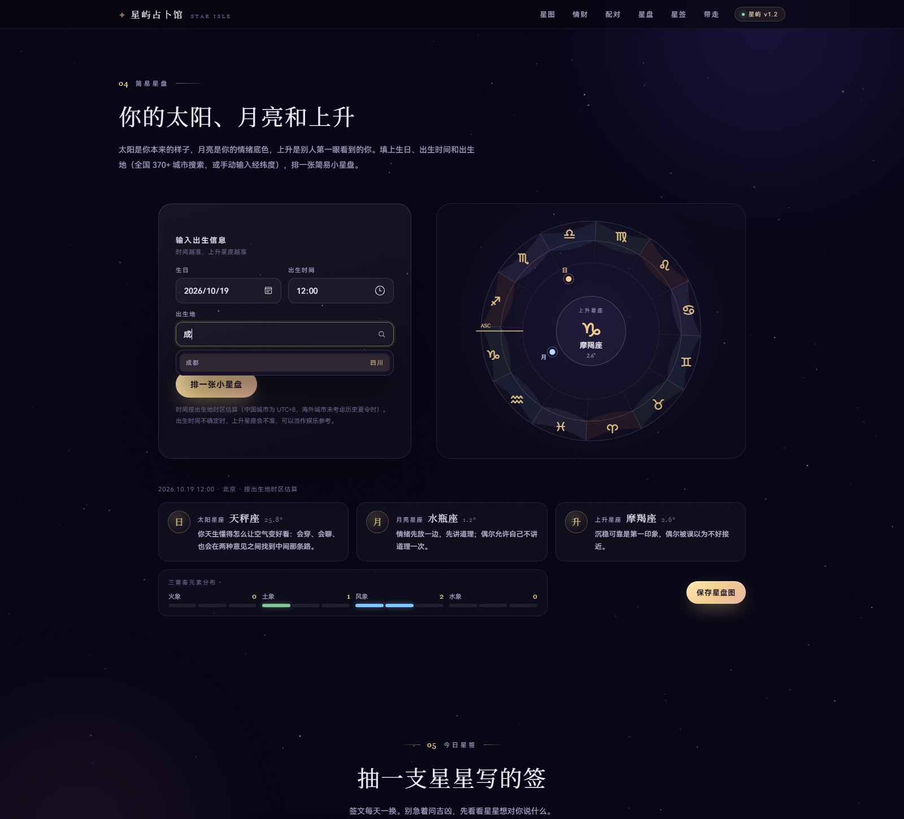

# 星屿占卜馆 · STAR ISLE ORACLE

一个可以发到社交平台的星座占卜小站：生日测星座、每日运势、爱情桃花与财运分析、双人配对、简易星盘、今日星签，还能生成分享海报和每日提醒。

纯静态、零依赖构建，双击 `index.html` 就能玩；也可以直接部署到 GitHub Pages / Vercel 当自己的小站。

**在线体验**：<https://fengsaoyusama.github.io/star-oracle/> · **源码仓库**：<https://github.com/fengsaoyusama/star-oracle>




## v1.2 功能

| 模块 | 说明 |
| --- | --- |
| 每日星图 | 生日 → 星座换算；综合指数、爱情/事业/财运星级、幸运色/数字/吉时/方位/贵人/幸运石、宜忌、今日提示、拍档参考 |
| 爱情与财运 | 桃花指数、心动/沟通/稳定、桃花方位/颜色/缘分星座/心动时辰、桃花签；财运指数、正财/偏财/理财、财神方位/招财色/幸运数字/进财吉时、搞钱建议、财神签 |
| 星轨配对 | 任意两个星座配对，综合指数 + 心动/默契/长久/沟通四维分数、点评、相处建议；一键交换位置 |
| 简易星盘 | 生日 + 出生时间 + 出生地（全国 370+ 城市搜索 / 手动经纬度 / 11 个海外亚洲城市）→ 太阳 / 月亮 / 上升星座，按城市时区估算，元素分布与星盘图可保存 PNG |
| 今日星签 | 3D 翻牌，签文按「星座 + 日期」生成；同一天同一星座内不重复（抽完 24 支才会循环） |
| 分享海报 | 今日星语 / 配对结果两种 1080×1440 海报，Canvas 本地生成、可直接保存 |
| 每日提醒 | 浏览器通知（页面开着时生效）+ `.ics` 日历文件（导入手机日历每天提醒） |
| 数据源切换 | 默认本地算法离线可用；可在运势卡里切换 ShowAPI 或自定义接口，失败自动回退本地 |
| 发布细节 | OG / Twitter 分享卡片、手机底部导航、`prefers-reduced-motion` 降级、无 JS 提示 |





## 本地运行

方式一：直接双击 `index.html`（普通 `<script>`，file:// 可运行）。

方式二：起一个静态服务器（推荐，剪贴板 / 分享 API 更稳）：

```powershell
cd star-oracle
python -m http.server 8899
# 打开 http://127.0.0.1:8899/
```

## 发布到线上

> 当前版本已部署在 GitHub Pages：<https://fengsaoyusama.github.io/star-oracle/>。更新站点可以运行 `node tools/deploy-github.mjs`（需要 `GITHUB_TOKEN` 环境变量），也可以按下面步骤部署到任意静态托管。

1. 把整个目录上传到任意静态托管（GitHub Pages / Vercel / Netlify / 对象存储）。
2. 打开 `index.html`，把最下面的配置改成你的网址：

   ```html
   <script>window.STAR_ORACLE_CONFIG = { siteUrl: 'https://你的域名' };</script>
   ```

   海报底部、「分享小站」卡片会显示这个网址。
3. 把 `<head>` 里的 `og:image` / `twitter:image` 换成**绝对地址**（如
   `https://你的域名/preview/og-cover.png`），微信 / 微博 / 小红书 / Twitter 抓取时才能显示封面。
4. 想用 ShowAPI 真实运势：运势卡右上角「本地星象」→ 万维易源 ShowAPI，填 AppKey。AppKey 只保存在访客自己的浏览器里。
   - 接口文档：<https://www.showapi.com/guides/horoscope-quickstart-872>
   - 浏览器若被跨域拦截，会自动回退本地数据；也可以自己部署一个反向代理，用「自定义接口」模式填代理地址。
5. 自定义接口返回以下任意一种结构即可：
   - ShowAPI 风格：`{ "showapi_res_code": 0, "showapi_res_body": { "ret_code": 0, "day": { ... } } }`
   - 简化风格：`{ "overall": 88, "love": 4, "career": 5, "money": 4, "luckyColor": { "name": "金色", "hex": "#f2c14e" }, "luckyNum": 7, "luckyTime": "21:00-23:00", "luckyDir": "正东", "luckyStar": "狮子座", "notice": "……", "tip": "……" }`

## 简易星盘是怎么算的

- 太阳黄经：Meeus 低精度公式，误差 < 0.01°
- 月亮黄经：Meeus 第 47 章截断周期项，误差约 0.1° 以内（用 2000 / 2024 年多次新月、满月相位校验）
- 上升星座：`atan2(cos θ, -(sin ε·tan φ + cos ε·sin θ))`，θ = 当地恒星时（GMST + 经度），φ = 纬度；并用「上升点高度角为 0、位于东方地平」做了自检
- 时区按城市所在时区估算：中国城市统一 UTC+8；海外仅收录无夏令时的亚洲城市（UTC+7 / +8 / +9）；也可手动输入经纬度
- 城市中心经纬度来自 [阿里 DataV 行政区划 GeoJSON](https://geo.datav.aliyun.com/areas_v3/bound/100000_full.json)（381 个城市，自动生成于 `src/city-data.js`）
- **仅供娱乐**：出生时间不确定时上升星座会不准；专业排盘请用专业软件

## 目录结构

```
star-oracle/
├─ index.html           # 页面结构 + 分享卡片 meta
├─ src/
│  ├─ data.js           # 12 星座资料、素材池、26 支星签、配对文案
│  ├─ lm-data.js        # v1.1 爱情/财运扩展数据（性格线、建议池、桃花签、财神签）
│  ├─ city-data.js      # v1.2 全国城市坐标库（381 城，自动生成）
│  ├─ astro.js          # 太阳/月亮/上升计算、星盘 SVG
│  ├─ online.js         # 在线数据源适配（ShowAPI / 自定义 / 本次缓存）
│  ├─ poster.js         # Canvas 分享海报 + 星盘 PNG 导出
│  ├─ reminder.js       # 通知调度 + .ics 日历文件
│  ├─ app.js            # 页面交互总控
│  ├─ style.css         # v0.1 基础视觉
│  └─ style-v1.css      # v1.0 – v1.2 组件视觉
├─ preview/             # 预览截图 / 社交封面 / 海报样例
├─ tools/               # 计算单测、模块单测、无头浏览器截图与自测脚本
└─ README.md
```

## 自测

```powershell
# 天文计算（21 项断言：儒略日、太阳黄经、日月相位、上升点高度角）
node tools/test-astro.mjs

# 在线源映射 / 日历文件 / 海报换行（18 项断言）
node tools/test-modules.mjs

# 爱情与财运板块（20 项断言：跟随星座、状态切换、桃花签/财神签换签、稳定性）
node tools/cdp-shot.mjs "http://127.0.0.1:8899/index.html#fortune" "preview/.tmp.png" 1600 1400 2200 1 tools/eval-lm.js 300

# 全国城市搜索 / 时区（18 项断言：城市库数量、搜索选择、键盘操作、海外时区、手动经纬度）
node tools/cdp-shot.mjs "http://127.0.0.1:8899/index.html#chart" "preview/.tmp.png" 1600 1000 2200 1 tools/eval-city.js 400

# 页面功能（需要先起本地服务器与无头浏览器，见 tools/）
node tools/cdp-shot.mjs "http://127.0.0.1:8899/index.html" "preview/.tmp.png" 1600 1000 2200 1 tools/eval-func-v1.js 300
```

页面功能自测共 91 项：星座交界日、生日联动、爱情/财运板块（状态切换、换签、跟随星座）、全国 370+ 城市搜索与时区、星盘计算与手动经纬度、配对/交换/稳定性、海报生成、数据源弹窗、日历文件、复制、手机底栏等；桌面 / 平板 / 手机视口都做过截图检查，控制台无报错。

## 数据口径与免责

- 星座日期采用中文星座站通行表（白羊 3.21 起、双鱼 3.20 止等），交界日各平台可能相差一天。
- 运势、配对、签文均为本地算法生成的娱乐内容；在线源接入后也同样**仅供娱乐**，不构成任何建议。
- 参考来源：
  - 星座日期 / 性格：[星座屋 · 十二星座](https://www.xzw.com/astro/)
  - 运势字段与免责口径：[万维易源 · 星座运势 API 指南](https://www.showapi.com/guides/horoscope-quickstart-872)
  - 生日→星座边界：[星座运势 API · date 参数](https://www.showapi.com/guides/horoscope-by-date-872)
  - 配对维度参考：[星座配对 API 指南](https://www.showapi.com/guides/constellation-match-quickstart-872)

## 下一步可以加

1. 完整星盘（宫位、十大行星）、真太阳时与出生地地图选点
2. 双人配对分享页 / 情侣合盘
3. 每日签文运营与节日专题
4. 部署后接入访问统计，看看大家最爱玩哪个模块
5. PWA 离线安装与推送（需要 Service Worker + 服务端推送）

## 小彩蛋

页脚那句「由一条爱摸鱼的大肥鱼捏出来的小站 🐋」是留给雨的。
